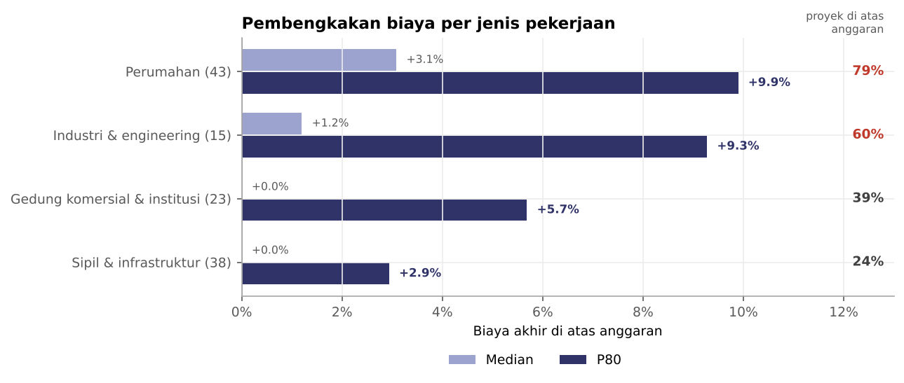
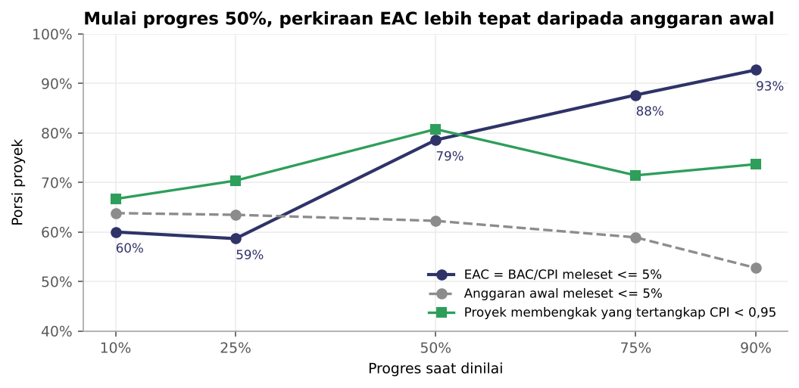
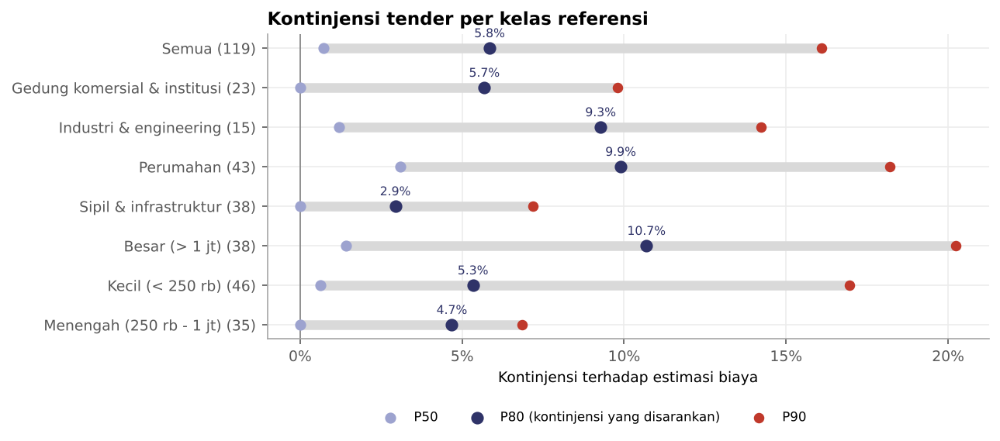

# Analisis Kinerja Biaya & Jadwal Proyek: Data Historis untuk Pengendalian Proyek dan Estimasi Tender

**Project Controls Analytics** · Excel (Power Query, PivotTable) · SQL · Python · Power BI

Analisis earned value pada **231 proyek nyata** dari database DSLIB (Ghent University) untuk menjawab dua kebutuhan kontraktor EPC: memantau proyek yang mulai melenceng dari anggaran, dan menentukan kontinjensi yang wajar saat menyusun harga tender. Laporan progres 155 proyek dikonsolidasikan menjadi satu sumber data. Hasilnya dianalisis di Excel dan Python, lalu dicek silang dengan SQL.



## Pertanyaan bisnis

1. Seberapa sering proyek selesai di atas anggaran dan terlambat, dan jenis pekerjaan mana yang paling berisiko?
2. Sejak progres berapa indikator CPI/EAC bisa dipercaya untuk memperingatkan pembengkakan biaya?
3. Berapa kontinjensi yang wajar saat menyusun harga tender, berdasarkan proyek historis?
4. Bagaimana pembengkakan biaya menggerus margin, dan apa kaitannya dengan produktivitas jam kerja?

## Hasil utama

Dianalisis: 119 proyek konstruksi dan engineering yang sudah selesai.

| Temuan | Angka |
|---|---|
| Proyek selesai di atas anggaran / terlambat | **51% / 72%** |
| Median rasio biaya akhir / anggaran | 1,007 (proyek tipikal hanya meleset tipis) |
| P80 / P90 rasio biaya | 1,058 / 1,161 (1 dari 10 proyek membengkak > 16%) |
| Jenis pekerjaan paling sering melampaui anggaran | Perumahan: 79% proyek, P80 +9,9% |
| Paling terkendali biayanya tetapi paling sering terlambat | Sipil & infrastruktur: 24% di atas anggaran, 87% terlambat |
| Akurasi EAC = BAC/CPI pada progres 10% → 50% | 60% → **79%** proyek meleset ≤ 5% (anggaran awal: 64% → 62%) |
| Sinyal CPI < 0,95 pada progres 50% | Menangkap **21 dari 26** proyek yang akhirnya membengkak > 5% (presisi 70%) |
| Kontinjensi P80 (diuji mundur, cakupan 77–79%) | Perumahan 9,9% · Industri & engineering 9,3% · Gedung 5,7% · Sipil 2,9% |
| Proyek merugi jika margin kontrak 10% | 16%, dan 27% kehilangan lebih dari separuh margin |

<p>


</p>

## Rekomendasi

1. **Review biaya wajib pada progres 50%.** Proyek dengan CPI < 0,95 masuk daftar tindak lanjut, dan EAC = BAC/CPI dipakai sebagai perkiraan biaya akhir resmi.
2. **Sebelum progres 50%**, CPI dilaporkan sebagai sinyal tren, bukan dasar revisi anggaran. Pada tahap ini angkanya masih bergejolak, meskipun arahnya sudah benar.
3. **Kontinjensi tender** memakai faktor P80 per jenis pekerjaan (sheet `Kalkulator_Tender`). Bila data kelas kurang dari 10 proyek, gunakan kelas semua proyek (+5,8%).
4. **Perumahan dan proyek besar** perlu perhatian khusus karena ekor pembengkakannya paling panjang (P80 +9,9% dan +10,7%).
5. **Standarkan laporan status site** dan wajibkan pencatatan jam kerja aktual. Saat ini hanya 38 dari 119 proyek yang punya data produktivitas.

## Alur kerja

```
DSLIB.zip (231 file ProTrack .p2x, XML)
  │  Python: parser + kalender kerja → PV, EV, AC per aktivitas per periode
  │          (hasil dicek identik dengan PMConverter, konverter resmi Ghent University)
  ▼
data/status_reports/  155 laporan status per proyek (CSV ; desimal koma)
data/processed/       proyek, aktivitas, periode_proyek
  │
  ├─ Power Query  → konsolidasi laporan → Excel: SUMIFS, INDEX/MATCH, VLOOKUP, IF, PERCENTILE, PivotTable
  ├─ SQL (SQLite) → skema, view, kueri analisis (window function, persentil)
  ├─ Python       → notebook analisis + uji mundur kontinjensi
  └─ Power BI     → model data + DAX (folder powerbi/)
```

## Workbook Excel

`excel/Analisis_Kinerja_Biaya_Jadwal_Proyek.xlsx`. Semua angka analisis berupa formula, tanpa formula error, dan bisa dibuka di Excel 2013 ke atas. Parameter cukup diubah di sheet `Asumsi`.

| Sheet | Isi | Fitur Excel |
|---|---|---|
| Ringkasan | Pertanyaan, angka kunci, temuan (teks dinamis), rekomendasi, navigasi | Hyperlink, teks dari formula |
| Asumsi | Batas CPI, batas pembengkakan, margin, kelas ukuran, milestone | Named range |
| Kamus | Pemetaan sektor (label sumber tidak seragam), istilah earned value | Tabel referensi |
| Laporan_Status | 6.878 baris gabungan 155 laporan proyek | **Power Query** |
| Data_Proyek | 231 proyek + kolom hitung (sektor bersih, rasio, status, kelas) | **VLOOKUP** (exact & approximate), **SUMIFS**, **IF** bertingkat, RANK |
| Data_Periode | 1.634 periode: PV/EV/AC, CPI, SPI, EAC, penanda milestone | **SUMIFS**, **INDEX/MATCH**, kolom kumulatif |
| Validasi | 18 pemeriksaan otomatis + log keputusan | COUNTIFS, SUMPRODUCT, EXACT |
| Kinerja_Portofolio | Realisasi per jenis pekerjaan dan ukuran, grafik | MEDIAN, PERCENTILE, AVERAGEIFS |
| Peringatan_Dini | Akurasi EAC dan ketepatan sinyal CPI per milestone | SUMIFS, COUNTIFS |
| Produktivitas | Faktor produktivitas jam kerja | INDEX/MATCH berurutan |
| Kelas_Referensi | Faktor P50/P80/P90 per kelas | PERCENTILE, SUMPRODUCT |
| Kalkulator_Tender | Input estimasi biaya, keluaran kontinjensi dan harga penawaran | Dropdown, **INDEX/MATCH dua arah**, VLOOKUP + MATCH |
| Skenario_Margin | Proyek rugi menurut margin kontrak | COUNTIF, grafik |
| Status_Proyek | Kartu status per proyek dan tabel per periode | Dropdown, INDEX/MATCH |
| Rekap | Status biaya per jenis dan rasio per ukuran | **2 PivotTable** |

Query Power Query ada di folder [`powerquery/`](powerquery/) beserta cara memasangnya. Laporan proyek baru cukup disalin ke folder `data/status_reports`, lalu Refresh All.

## SQL, Python, Power BI

- **SQL** (`sql/schema.sql`, `sql/analysis.sql`): skema dengan primary/foreign key, view `v_portofolio` dan `v_periode`, serta enam kueri analisis, termasuk persentil dengan interpolasi (setara PERCENTILE di Excel) memakai window function.
- **Python** (`src/project_controls/`, `notebooks/project_controls_analysis.ipynb`): parser ProTrack dengan kalender kerja, pipeline data, analisis, grafik, dan uji mundur leave-one-out untuk kontinjensi tender.
- **Power BI** (`powerbi/`): rumus DAX untuk kolom hitung dan ukuran (CPI, SPI, EAC, P80, kalkulator kontinjensi), tema warna, dan rancangan tiga halaman dashboard. File `.pbix` dirakit di Power BI Desktop mengikuti panduan di folder tersebut.

## Konsistensi antar-alat

`tests/test_parity.py` (7 test) memeriksa:
- kalender kerja;
- aturan rekonsiliasi;
- kesamaan hasil **Python vs SQL vs Excel**: ringkasan portofolio, kinerja per kelas, rasio setiap proyek, peringatan dini di 5 milestone, faktor P50/P80/P90, dan skenario margin;
- tidak ada nilai error di workbook.

Selisih Excel–Python di bawah 10⁻⁵, berasal dari pembulatan 2 desimal di file laporan status.

```bash
pytest -q        # 7 passed
```

## Kualitas data

| Temuan | Penanganan |
|---|---|
| Di 21 proyek batch 2024–2025, biaya aktual dicatat tanpa biaya sumber daya, padahal anggaran memuatnya; proyek tampak hemat 10–64% | Dideteksi dengan aturan tertulis, lalu anggaran (BAC, PV, EV) proyek tersebut dihitung tanpa biaya sumber daya; rasio biaya kembali ke 0,96–1,01 |
| Anggaran di ringkasan resmi DSLIB berbeda dengan file di 11 proyek (mis. 10x lipat, angka proyek lain tersalin) | File proyek dipakai sebagai sumber utama; selisih dicatat per proyek |
| Satu proyek tanpa biaya aktual (AC = 0) | Dikeluarkan dari analisis biaya |
| Label sektor tidak seragam (`Civil`/`civil`, `Event Management`/`management`) | Diseragamkan lewat tabel pemetaan |
| Mata uang campuran (euro, dolar, zloty) | Semua ukuran memakai rasio; nilai uang tidak dijumlahkan antar proyek |
| 76 proyek tanpa laporan pemantauan, 7 belum selesai | Tetap di data master, tidak masuk analisis kinerja |

Hasil rekonsiliasi dengan ringkasan resmi: anggaran cocok di 185 dari 196 proyek dan biaya aktual akhir cocok di 140 dari 145 proyek selesai. Selisih yang tersisa sudah ditelusuri satu per satu.

## Keterbatasan

- DSLIB sebagian besar berisi proyek konstruksi di Belgia, ditambah proyek sipil di Peru. Belum ada proyek pertambangan atau migas, sehingga faktor kontinjensi perlu dikalibrasi ulang dengan data internal perusahaan. Metodenya tetap sama.
- Nilai kontrak tidak tersedia, jadi analisis margin adalah skenario.
- Kelas industri & engineering hanya berisi 15 proyek, sehingga persentilnya kurang stabil.
- Data jam kerja hanya ada di 38 proyek, sehingga analisis produktivitas bersifat indikatif.

## Struktur repositori

```
project-controls-analytics/
├── data/
│   ├── raw/DSLIB.zip                 # data asli: 231 file ProTrack + lembar ringkasan (branch protrack-data repo DSLIB)
│   ├── processed/                    # proyek, aktivitas, periode_proyek, aktivitas_periode
│   ├── status_reports/               # 155 laporan status per proyek (sumber Power Query)
│   └── summary/                      # tabel ringkasan untuk Power BI
├── excel/Analisis_Kinerja_Biaya_Jadwal_Proyek.xlsx
├── powerquery/                       # query M + panduan
├── sql/                              # schema.sql, analysis.sql
├── powerbi/                          # measures.dax, tema, panduan dashboard
├── notebooks/project_controls_analysis.ipynb
├── src/project_controls/
│   ├── protrack.py    # parser ProTrack, kalender kerja, PV/EV/AC
│   ├── dataset.py     # ekstraksi, rekonsiliasi, aturan kualitas data
│   ├── analysis.py    # kinerja, peringatan dini, kelas referensi, margin, produktivitas
│   ├── db.py          # database SQLite dan kueri
│   ├── pipeline.py    # DSLIB.zip → semua tabel
│   └── plots.py
├── reports/figures/
└── tests/test_parity.py
```

## Cara menjalankan

```bash
git clone https://github.com/kafkafadillah/project-controls-analytics.git
cd project-controls-analytics
python -m venv .venv && source .venv/bin/activate     # Windows: .venv\Scripts\activate
pip install -r requirements.txt
pip install -e .

python -m project_controls.pipeline                   # ekstraksi ulang dari DSLIB.zip (< 1 menit)
jupyter lab notebooks/project_controls_analysis.ipynb
pytest -q
```

## Sumber data dan lisensi

Data: **DSLIB – Dynamic Scheduling Empirical Project Library**, Operations Research & Scheduling Research Group, Ghent University, versi 3.4 (September 2026), [github.com/MarioVanhoucke/DSLIB-Dynamic-Scheduling-Empirical-Project-Library](https://github.com/MarioVanhoucke/DSLIB-Dynamic-Scheduling-Empirical-Project-Library). Data disediakan untuk keperluan akademik dan wajib disitasi:

> Batselier, J., & Vanhoucke, M. (2015). Construction and evaluation framework for a real-life project database. *International Journal of Project Management*, 33(3), 697–710. https://doi.org/10.1016/j.ijproman.2014.09.004

Kode, notebook, dan workbook: [MIT](LICENSE) © 2026 Khafka Fadillah Wibawa Nurdiansyah. Lisensi MIT tidak berlaku untuk data DSLIB.
